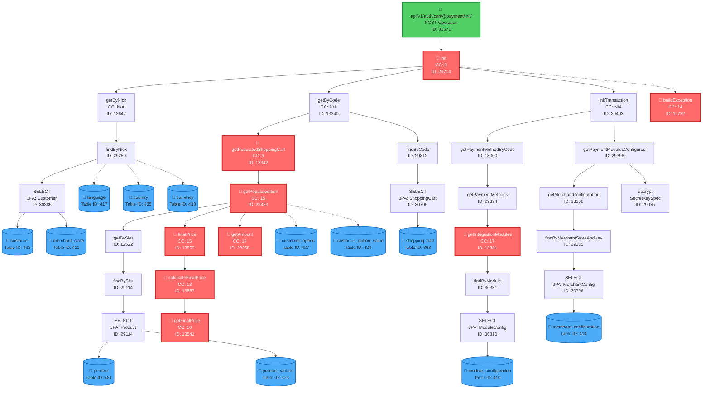

# API Endpoint Documentation: `api/v1/auth/cart/{}/payment/init/` (POST)

**Application:** Shopizer-Backend  
**Endpoint:** `api/v1/auth/cart/{code}/payment/init/`  
**HTTP Method:** POST  
**Transaction ID:** 244094  
**Total Call Graph Size:** 643 nodes

---

## 1. Technical Documentation

### 1.1 Endpoint Overview

- **Full Method Name:** `com.salesmanager.shop.store.api.v1.order.OrderPaymentApi.init`
- **Method ID:** 29714
- **Source File:** `sm-shop/src/main/java/com/salesmanager/shop/store/api/v1/order/OrderPaymentApi.java`
- **Number of Code Lines:** 47
- **Cyclomatic Complexity:** 9
- **Status:** Added

### 1.2 Annotations

```java
@RequestMapping(value={"/auth/cart/{code}/payment/init"}, method=RequestMethod.POST)
@ResponseBody
@ApiImplicitParams({
    @ApiImplicitParam(name="store", dataType="String", defaultValue="DEFAULT"),
    // Additional parameters
})
```

### 1.3 Method Signature

```java
init(
    com.salesmanager.shop.model.order.transaction.PersistablePayment payment,
    java.lang.String code,
    com.salesmanager.core.model.merchant.MerchantStore store,
    com.salesmanager.core.model.reference.Language language
)
```

### 1.4 Technology Stack

The endpoint utilizes the following technology layers:
- **Hibernate** - ORM layer
- **Java** - Programming language
- **Spring** - Application framework
- **Spring Web Services** - REST API framework
- **SQL/PostgreSQL** - Database layer

### 1.5 Database Tables Accessed

The transaction interacts with the following database tables:

| Table Name | Type | Purpose |
|------------|------|---------|
| `merchant_store` | Main table | Store configuration and settings |
| `customer` | Main table | Customer information |
| `shopping_cart` | Main table | Shopping cart data |
| `product` | Main table | Product information |
| `payment_method` | Configuration | Payment method configuration |
| `module_configuration` | Configuration | Module settings |
| `merchant_configuration` | Configuration | Merchant-specific configuration |
| `product_variant` | Related | Product variant details |
| `product_variation` | Related | Product variations |
| `product_variant_group` | Related | Product variant groupings |
| `product_option` | Related | Product options |
| `product_option_value` | Related | Product option values |
| `customer_option` | Related | Customer-specific options |
| `customer_option_value` | Related | Customer option values |
| `language` | Reference | Language settings |
| `country` | Reference | Country information |
| `currency` | Reference | Currency data |
| `tax_class` | Reference | Tax classifications |
| `manufacturer` | Reference | Manufacturer data |
| `product_type` | Reference | Product type categorization |
| `geozone` | Reference | Geographic zones |

### 1.6 High Complexity Methods

The following methods in the call graph have **cyclomatic complexity > 10**:

| Method Name | Cyclomatic Complexity | Essential Complexity | Integration Complexity |
|-------------|----------------------|---------------------|------------------------|
| `getIntegrationModules` | **17** | 2 | 17 |
| `getPopulatedItem` | **15** | 9 | 15 |
| `finalPrice` | **15** | 1 | 15 |
| `buildException` | **14** | 1 | 13 |
| `getAmount` | **14** | 8 | 12 |
| `calculateFinalPrice` | **13** | 2 | 12 |

### 1.7 Key Dependencies

#### Direct Method Calls (Depth 1)
- `getByNick` - Retrieve customer by nickname/code
- `getByCode` - Retrieve shopping cart by code
- `initTransaction` - Initialize payment transaction

#### Core Business Logic Methods
- `getPaymentMethodByCode` - Fetch payment method configuration
- `getPaymentModulesConfigured` - Get configured payment modules
- `getPopulatedShoppingCart` - Build complete shopping cart with items
- `getPopulatedItem` - Populate individual cart item details

#### Data Access Methods
- JPA Entity Operations (SELECT operations)
- Custom repository methods (`findByNick`, `findByCode`, `findBySku`, etc.)

### 1.8 Security Considerations

The endpoint uses:
- **Authentication required** (`/auth/` path prefix)
- Encryption/decryption through `SecretKeySpec` class
- `decrypt` method for sensitive configuration data

---

## 2. Functional Documentation

### 2.1 Business Purpose

This endpoint initializes a payment transaction for a shopping cart. It serves as the entry point for the checkout process, preparing all necessary data before redirecting the customer to the payment gateway.

### 2.2 Functional Flow

1. **Customer & Cart Retrieval**
   - Validates the customer by nickname/code
   - Retrieves the shopping cart associated with the provided code
   - Ensures the cart belongs to the authenticated customer

2. **Shopping Cart Population**
   - Fetches all cart items with complete product details
   - Calculates pricing for each item including:
     - Base product price
     - Product variants and options
     - Tax calculations
     - Final price computation

3. **Payment Configuration**
   - Retrieves payment method by code from the request
   - Loads configured payment modules for the merchant
   - Fetches merchant-specific payment configuration
   - Decrypts sensitive payment credentials if needed

4. **Transaction Initialization**
   - Creates a payment transaction record
   - Associates the transaction with the cart and customer
   - Prepares payment gateway integration data
   - Returns transaction details for frontend processing

### 2.3 Input Parameters

| Parameter | Type | Description | Required |
|-----------|------|-------------|----------|
| `payment` | PersistablePayment | Payment details including method code and metadata | Yes |
| `code` | String | Shopping cart code (path variable) | Yes |
| `store` | MerchantStore | Current merchant store context | Yes (implicit) |
| `language` | Language | User's language preference | Yes (implicit) |

### 2.4 Business Rules

1. **Cart Validation**
   - Cart must exist and belong to the requesting customer
   - Cart must contain at least one item
   - All products in cart must be available and active

2. **Payment Method Validation**
   - Payment method must be configured for the merchant
   - Payment module must be active and properly configured
   - Merchant must have valid credentials for the payment gateway

3. **Price Calculation**
   - Prices are calculated with tax considerations
   - Product variants affect final pricing
   - Currency conversion applied based on merchant settings

4. **Error Handling**
   - Comprehensive exception building for various failure scenarios
   - Validation of all entities before transaction creation

### 2.5 Output

Returns a payment initialization response containing:
- Transaction ID
- Payment gateway URL or token
- Order summary with final amounts
- Payment method details
- Redirect parameters for payment gateway

### 2.6 Related Transactions

This endpoint is part of a larger payment workflow:
- **Precedes:** Payment capture/authorization endpoints
- **Follows:** Shopping cart management operations
- **Related:** `api/v1/cart/{}/payment/init/` (non-authenticated variant)

### 2.7 Data Flow Summary

```
Customer Request → Validate Cart → Load Cart Items → Calculate Prices
                                                           ↓
Payment Response ← Initialize Transaction ← Configure Payment ← Load Payment Methods
```

---

## 3. Call Graph Visualization

### 3.1 Complete Call Graph with Complexity Highlighting

The following Mermaid diagram shows the complete call graph for this endpoint. **Nodes highlighted in red** represent methods with **cyclomatic complexity > 10**.



### 3.2 Legend

- 🔵 **Blue Circle** - API Endpoint (Starting Point)
- 🔴 **Red Box** - High Complexity Method (CC > 10)
- 💾 **Database Cylinder** - Database Table
- **Solid Lines** - Direct method calls
- **Dotted Lines** - Data references or indirect calls
- **CC** - Cyclomatic Complexity

### 3.3 Critical Path Analysis

The critical path through the most complex methods:

1. `api/v1/auth/cart/{}/payment/init/` (Start)
2. → `init` (CC: 9)
3. → `getPopulatedShoppingCart` (CC: 9)
4. → `getPopulatedItem` (CC: 15) **← High Complexity**
5. → `finalPrice` (CC: 15) **← High Complexity**
6. → `calculateFinalPrice` (CC: 13) **← High Complexity**

**Recommendation:** The pricing calculation chain (`getPopulatedItem` → `finalPrice` → `calculateFinalPrice`) contains multiple high-complexity methods and should be prioritized for refactoring and unit testing.

---

## 4. Quality Insights

### 4.1 Detected Issues

The method manifests **2 insight types** (quality concerns). These should be reviewed for:
- Performance optimization opportunities
- Code maintainability improvements
- Security enhancements

### 4.2 Testing Recommendations

**Priority 1 - Critical Path Testing:**
- Test the complete payment initialization flow
- Validate cart retrieval with various cart states
- Test payment method selection and configuration loading

**Priority 2 - Complex Method Testing:**
- Unit tests for `getIntegrationModules` (CC: 17)
- Unit tests for `getPopulatedItem` (CC: 15)
- Unit tests for `finalPrice` (CC: 15)
- Unit tests for `calculateFinalPrice` (CC: 13)

**Priority 3 - Integration Testing:**
- Test database interactions with all 20 tables
- Test encryption/decryption of payment credentials
- Test error handling and exception scenarios

### 4.3 Related Data Graphs

This endpoint is involved in **18 data entity interaction networks**, indicating significant data processing and transformation logic.

---

## 5. Dependencies and Impact

### 5.1 Incoming Dependencies

- **1 caller** uses this endpoint (likely frontend/UI components)

### 5.2 Outgoing Dependencies

- **47 callees** - This method calls 47 other methods
- **20 database tables** - Direct or indirect access
- **Multiple JPA operations** - Entity retrieval and persistence

### 5.3 Change Impact Assessment

**HIGH IMPACT** - Changes to this endpoint affect:
- Payment processing workflow
- Shopping cart functionality
- Price calculation logic
- Multiple downstream payment operations
- Customer checkout experience

**Recommended approach for modifications:**
1. Ensure comprehensive test coverage before changes
2. Use feature flags for incremental rollout
3. Monitor payment success rates after deployment
4. Maintain backward compatibility for API consumers

---

## 6. Notes and References

- **Source Code Location:** `sm-shop/src/main/java/com/salesmanager/shop/store/api/v1/order/OrderPaymentApi.java`
- **Parent Class:** `OrderPaymentApi` (ID: 29357)
- **Programming Language:** Java
- **Framework Version:** Spring MVC with Swagger/OpenAPI annotations
- **Authentication:** Required (`/auth/` prefix)
- **Total Transaction Size:** 643 nodes in complete call graph

---

*Documentation generated from CAST Imaging analysis on January 21, 2026*
